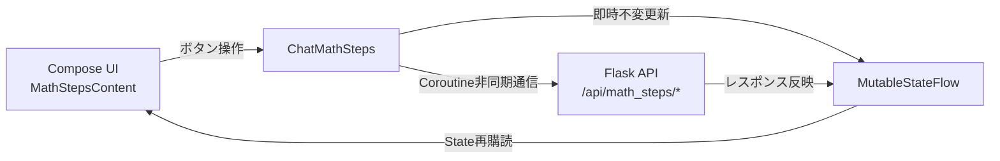

# 数学ステップ解説：Androidクライアント実装

本ドキュメントでは、公式Androidクライアント（`app/android/`）における「数学ステップ解説」のアーキテクチャ、Jetpack ComposeによるUI実装、不変状態管理、Web版との同期仕様、およびサーバーレスモードでの対応を解説します。

---

## 1. Web版との同期方針

プロジェクト規約（`AGENTS.md`）に基づき、Android版は**「Web版と見分けがつかない状態」**を目標として設計されています。
- 見た目、文言、カラー、ボタンスタイル、アクセシビリティ表示、設定項目の配置をWeb版と完全同期。
- データのシリアライズ形式（JSON）および上限値（最大50ステップ、1ステップ20,000文字、合計100,000文字）も共通の規約に従います。

---

## 2. データ構造とモデル定義（`data/MathSteps.kt`）

`android/app/src/main/java/com/minashin1120/aiplayground/data/MathSteps.kt`（218行）に、数学ステップ機能のモデルとパーサーが実装されています。

### 2.1 `MathStepsConfig`（ユーザー設定モデル）
```kotlin
data class MathStepsConfig(
    val basics: Boolean = false,
    val level: String = "easy",
    val stepSize: String = "normal",
    val diagrams: String = "auto",
    val animation: Boolean = true,
)
```
- `toJson()`: サーバー（`/api/mobile/preferences`）保存用のJSONオブジェクトを生成。
- `promptValues()`: サーバー不使用（直接API通信）モード時に、サーバーと同じ文言でプロンプトパラメータを生成。
- `parse(raw: Any?)`: サーバーから返されたJSONまたは文字列を安全にパース。欠損値や未知の値はデフォルト値にフォールバック。

### 2.2 `MathStepsState`（メッセージ進捗モデル）
```kotlin
data class MathStepsState(
    val current: Int = 0,
    val maxReached: Int = 0,
    val simplified: Map<Int, String> = emptyMap(),
)
```
- `withCurrent(index: Int)`: 現在位置を更新し、`maxReached` も必要に応じて引き上げ。
- `withSimplified(index: Int, text: String)`: 簡略化された解説を不変Mapに追加。
- `MAX_STEP = 50`, `MAX_SIMPLIFIED_CHARS = 20_000`, `MAX_SIMPLIFIED_TOTAL = 100_000` の上限ガードを内蔵。

### 2.3 `extractMathSteps(text: String)`（ステップ解析）
Web版の `parseMathSteps()` と同一の正規表現を使用し、回答テキストを `List<MathStep>` に分解します。
- コードフェンス（```` ``` ```` や ```` ~~~ ````）内の行は除外して誤認を防止。
- 導入文（Preamble）は最初のステップに合流。

---

## 3. 非同期通信と状態管理（`ChatMathSteps.kt`）

サーバー通信と画面状態の同期は、`ChatMathSteps.kt`（128行）が担当します。



### 3.1 楽観的UI更新（Optimistic Update）
- ユーザーが「ステップを進める」操作を行った際、通信完了を待たずに `updateState` で `StateFlow` のメッセージオブジェクトを不変更新します。
- これにより、ネットワーク遅延に関係なく即座に次のステップが表示されます。
- 万一通信が失敗した場合でも、ローカルの回答テキストは閲覧可能なため、トースト等でユーザーの閲覧を妨げることはせず、診断ログ（`Diagnostics.log("math_steps.progress_error")`）のみを記録します。

### 3.2 ライフサイクルと通信キャンセル
- アカウントログアウトやアカウントBANが発生した場合は、`activeJob`（実行中の `Job`）が自動的にキャンセルされ、リークを防止します。

---

## 4. UIコンポーネント（`ui/MathSteps.kt`）

Jetpack Composeにより、Material 3とWeb版のCSSデザインを融合させたコンポーネント群が構築されています。

### 4.1 `MathStepsContent`（ステップ表示本体）
- **プログレスバー**: 全体ステップ数に対する現在の進行度合いを視覚的に表示。
- **KaTeX数式レンダリング**: AndroidネイティブのMarkdownパーサーおよびLaTeXビューアと連携。
- **アクションボタン群**:
  - メインボタン: 次のステップへ進む大型ボタン（「ステップ 2 へ」「解き終わった！」）。
  - サブボタン: 「前へ」「最初から」「もっとやさしく」の丸型チップボタン。
  - 「元の説明に戻す」ボタン: 簡略化が適用されているステップのみに点線枠で表示。

### 4.2 `SvgAnimation.kt` と `mathsvg` の描画
AIが回答内に ````mathsvg```` を含んでいた場合、Android側では `SvgAnimation.kt` を利用してインライン表示されます。
- SVG内のSMILアニメーションおよびキーフレームアニメーションを解析して再生。
- 端末のアクセシビリティ設定「アニメーションを無効化」がONの場合は、静止画として描画されます。

### 4.3 `MathStepsSettingsDialog`（設定ダイアログ）
プロンプトバーの歯車アイコン（`MathStepsGear`）をタップすると、Web版と全く同じ設定項目を持つモーダルダイアログが開きます。
- 基礎から説明する（Switch）
- 説明の詳しさ（DropdownMenu）
- 1ステップの大きさ（DropdownMenu）
- 図の使用（DropdownMenu）
- 図のアニメーション（Switch）

---

## 5. サーバーレス（直接API通信）モードでの動作

Androidクライアント固有の機能である「サーバー不使用モード（BYOK: 端末ローカルから各AIプロバイダーへ直接通信するモード）」でも、数学ステップ機能は完全に動作します。

- `data/direct/SystemPromptBuilder.kt` において、`mathStepsConfig.promptValues()` を展開し、直接通信用のシステムプロンプトに数学ステップ規約を結合します。
- 生成された回答は端末ローカルの `extractMathSteps()` で分解され、サーバーが存在しなくても同じステップ解説UIが提供されます。
