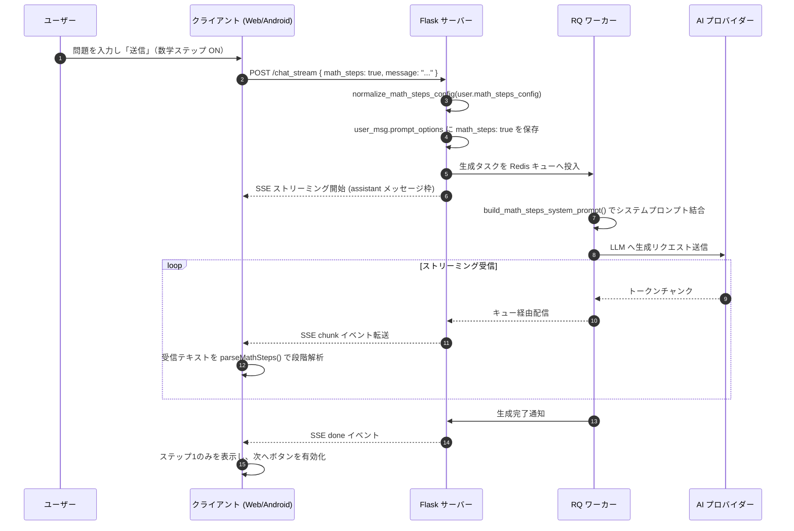
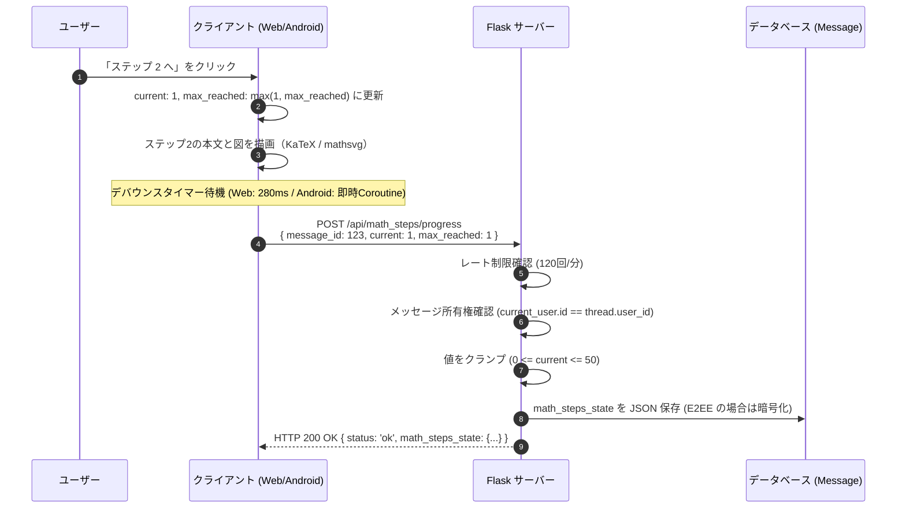
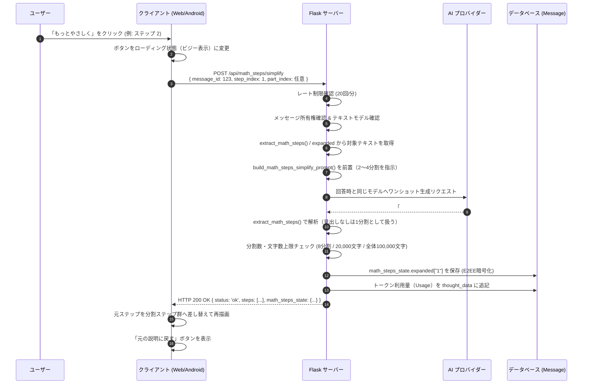

# 数学ステップ解説：アーキテクチャと処理フロー

本ドキュメントでは、「数学ステップ解説」機能の全体アーキテクチャ、処理の流れ、シーケンス図、およびデータ永続化と暗号化（E2EE）の仕組みを解説します。

---

## 1. 全体アーキテクチャ概要

数学ステップ解説は、プロンプトによる回答形式の制御、クライアント側での段階的レンダリング、サーバー側での進捗永続化、およびオンデマンドのステップ分割（再生成）から構成されます。

```mermaid
flowchart TD
    subgraph Client [クライアント層 (Web / Android)]
        UI[ステップ解説UI<br>KaTeX数式 / mathsvg描画]
        Parser[ステップパーサー<br>## ステップ N の解析]
        State[進捗状態管理<br>current / max_reached / expanded]
    end

    subgraph Server [サーバー層 (Flask / RQ)]
        API[routes_math_steps.py<br>/api/math_steps/*]
        Stream[routes_stream.py / background.py<br>システムプロンプト動的注入]
        Core[background_math_steps.py<br>プロンプト生成・抽出・設定正規化]
    end

    subgraph Storage [データ・キュー層]
        DB[(MySQL / SQLite<br>User / Message)]
        Redis[(Redis / RQ)]
    end

    subgraph Provider [AIプロバイダー]
        LLM[Gemini / OpenAI / Anthropic / xAI 等]
    end

    UI --> Parser
    Parser --> State
    State -->|進捗保存 POST| API
    State -->|もっとやさしく POST| API
    API --> Core
    API --> DB
    API -->|ステップ再生成| LLM
    Stream --> Core
    Stream --> Redis
    Redis --> LLM
```

---

## 2. 処理フローとシーケンス

### 2.1 チャット送信とストリーミング生成フロー

ユーザーが「数学ステップ」を有効にしてメッセージを送信した際、システムプロンプトに数学家庭教師ペルソナと出力形式規約が結合されます。



#### ブラウザ高速モード（Browser Fast Mode）の場合
ブラウザ高速モード（Gemini APIキーを端末に持ち、クライアントから直接Geminiへ通信するモード）では、以下のフローとなります。
1. クライアントが `POST /api/browser_fast_mode/bootstrap` を呼び出す際、`math_steps: true` を渡します。
2. サーバー（`server/routes_browser_fast.py`）はレスポンスに `math_steps_system_prompt`（ユーザー設定を反映したシステムプロンプト）を含めて返します。
3. クライアントはGeminiへの直接リクエスト時にこのプロンプトをシステム指示として渡し、回答を受信します。
4. 会話保存時（`POST /api/browser_fast_mode/save`）に、`prompt_options` へ `math_steps: true` が記録されます。

---

### 2.2 ステップ進行と進捗保存フロー

ユーザーが「ステップ 2 へ」などのボタンを押した際、クライアントは即座にUIを更新（楽観的UI更新）し、バックグラウンドで進捗をサーバーへ保存します。



---

### 2.3 「もっとやさしく」再生成（ステップ分割）フロー

理解が難しいステップで「もっとやさしく」ボタンを押すと、そのステップが平易な複数の小さなステップへ分割され、元の回答に差し込まれます。読み手は増えたステップをそのまま順に進められます。



---

## 3. データモデルと永続化

### 3.1 ユーザー設定（`User` モデル）

ユーザーのアカウント設定として、以下のカラムが追加されています（`server/models.py` L48-L50）。

| カラム名 | 型 | 既定値 | 説明 |
|---|---|---|---|
| `math_steps_enabled` | Boolean | `False` | 数学ステップ機能の全体スイッチ（マスター設定）。ONにするとプロンプトバーにチップが表示されます。 |
| `math_steps_config` | Text | `None` | 詳細設定を保持するJSON文字列。 |
| `default_math_steps` | Boolean | `False` | 新規チャット作成時にプロンプトバーの数学ステップを既定でONにするかどうか。 |

#### `math_steps_config` のJSON構造
```json
{
  "basics": false,
  "level": "easy",
  "step_size": "normal",
  "diagrams": "auto",
  "animation": true
}
```
- `basics` (bool): 基礎から説明するかどうか（前提公式の復習の有無）
- `level` (str): `"easy"`（やさしい）, `"normal"`（ふつう）, `"detailed"`（くわしい）
- `step_size` (str): `"small"`（小さめ）, `"normal"`（ふつう）, `"large"`（大きめ）
- `diagrams` (str): `"auto"`（必要なら使う）, `"off"`（使わない）
- `animation` (bool): 図のアニメーションを許可するかどうか

---

### 3.2 メッセージ進捗状態（`Message` モデル）

AI回答メッセージ（`role == "assistant"`）の進捗状態は、`math_steps_state` カラム（Text、`server/models.py` L188）に保持されます。

#### `math_steps_state` のJSON構造
```json
{
  "current": 2,
  "max_reached": 4,
  "simplified": {},
  "expanded": {
    "1": [
      { "title": "やさしく整理", "body": "やさしい解説1..." },
      { "title": "やさしく計算", "body": "やさしい解説2..." }
    ]
  }
}
```
- `current` (int): 現在表示しているステップのインデックス（0始まり、最大50）。分割後の表示順で数えます。
- `max_reached` (int): ユーザーが到達した最大のステップインデックス。一度到達した値より小さくなることはありません。
- `simplified` (dict[str, str]): 旧形式の「もっとやさしく」代替テキスト。既存データの読み込みと「元の説明に戻す」のために保持します。
- `expanded` (dict[str, list[dict]]): 「もっとやさしく」で分割したステップ。キーは元ステップのインデックス文字列、値は `{title, body}` のリストです。クライアントは元ステップの位置にこのリストを差し込んで表示し、`part_index` を指定して小ステップをさらに分割できます。

---

## 4. エンドツーエンド暗号化（E2EE）への対応

AI Chat Playground では、ユーザーが暗号化会話を有効にしている場合、メッセージ本文および付随するメタデータがクライアントとサーバー間で暗号化されます。数学ステップ機能でも、プライバシー保護の観点からE2EEとの完全な統合が行われています。

1. **読み出し時の自動復号（`server/routes_math_steps.py` L59-L68）**
   - メッセージの `is_encrypted` フラグが真である場合、保存された `math_steps_state` を `decrypt_val()` で復号してからパースします。
   - 回答本文（`_math_steps_message_content`）も `decrypt_val()` を経由して復号されます。
2. **書き込み時の自動暗号化（`server/routes_math_steps.py` L70-L76）**
   - 更新された状態JSON文字列を `encrypt_val()` で暗号化してから `message.math_steps_state` にセットしてコミットします。
3. **Usage記録の保護（`server/routes_math_steps.py` L122-L142）**
   - ステップ簡略化で消費されたトークン使用量は `message.thought_data` に記録されますが、こちらも暗号化メッセージの場合は暗号化して保存されます。
4. **アカウントデータ移行（エクスポート/インポート）**
   - エクスポート時（`server/account_transfer.py` L417-L420）は平文に復号してエクスポートアーカイブに格納。
   - インポート時（`server/routes_account_import.py` L587-L596）はアカウントの暗号化設定に応じて再暗号化して保存されます。
