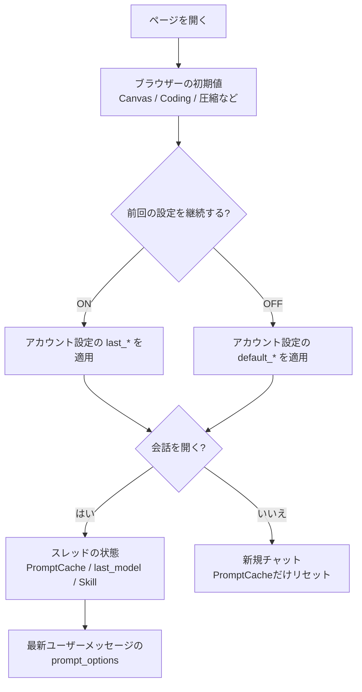

# プロンプトバーの設定と復元

プロンプトバー（入力欄の周囲にあるモデル選択と各チップ）の設定が、どこに保存され、どの順序で復元されるかを解説します。対象は2026年11月1日時点のリポジトリ実装です。項目の表示条件や既定値はモデル追加・廃止に合わせて変わるため、実際の画面と異なる場合はコードを正としてください。

## 1. 設定の保存先

プロンプトバーの状態は、次の4か所に分かれて保存されます。

| 保存先 | 内容 | 例 |
|---|---|---|
| プロンプト単位のスナップショット | 送信時点のプロンプトバー設定。ユーザーメッセージごとに保持 | `Search`、`Thinking`、画像生成のサイズ・品質、マスク参照 |
| スレッドの状態 | その会話で最後に使ったモデル、PromptCache、Skill、一時チャット | `last_model`、`enable_prompt_caching` |
| アカウント設定 | 全端末で共有する既定値と「前回の設定」 | `default_enable_search`、`last_enable_search` |
| ブラウザーの保存領域 | そのブラウザーだけに残る表示・動作の初期値 | Canvas、Coding、低帯域モード、圧縮の詳細値 |

画面を開いたときは、おおむね「ブラウザーの初期値 → アカウント設定 → スレッドの状態 → プロンプト単位のスナップショット」の順に適用され、後のものほど優先されます。

## 2. 復元される設定・されない設定

プロンプト単位のスナップショットに含まれるのは、送信時のプロンプトバーの選択内容です。次の項目が対象になります。

- モデル、Canvas、Coding、高速モード、Batch
- Search、URLs、Maps、Python、File、MCP
- Thinking のオン・オフ、レベル、Budget、Reasoning effort
- Safety
- PromptCache、Vision Model、マスク画像の参照
- 画像・動画・音楽・OCR・TTS の生成オプション
- xAI のサンプリング設定（temperature、top_p、seed など）

一方、次の項目はプロンプト単位では保存されません。

| 項目 | 実際の扱い |
|---|---|
| SysPrompt のオン・オフ | アカウント設定の既定値または前回値から復元し、モデル切替時の一時的な無効化だけ別に戻す |
| 圧縮（Compress）のオン・オフ | ページ内の状態のみ。圧縮の詳細値（上限サイズ・最大辺・形式）はブラウザーに保存 |
| 一時チャット | スレッドの状態として復元（プロンプト設定ではない） |
| チャット設定（カスタム指示、全体システムプロンプト、自動注入の案内文） | スレッド設定・アカウント設定として保存 |
| システムプロンプトの本文 | アカウント設定として保存 |
| TTS のスタイル、Ideogram のネガティブプロンプト、xAI の stop など自由記述欄 | 編集中のキャンセル用にメモリー上だけで保持し、送信後のスナップショットには含めない |

## 3. ページを開いたとき

ページの初期化では、アカウント設定を取得して `applyChatDefaults` が一度だけ適用されます（`chatDefaultsLoaded`）。以後、設定を再取得してもプロンプトバーを上書きしません。

「前回の設定を保存して継続する」がONの場合は `last_*`、OFFの場合は `default_*` を使います。

| プロンプトバー | 前回の設定（ON） | 既定の設定（OFF） |
|---|---|---|
| モデル | `last_model` | `default_model` |
| Search / URLs / Maps | `last_enable_*` | `default_enable_*` |
| Python / File | `last_enable_*` | `default_enable_*` |
| Thinking とレベル・Budget | `last_enable_thinking`、`last_thinking_level`、`last_thinking_budget` | 同名の `default_*` |
| Reasoning effort | `last_reasoning_effort` | `default_reasoning_effort` |
| SysPrompt | `last_enable_system_prompt` | `default_enable_system_prompt` |
| MCP | `last_enable_mcp` | `default_enable_mcp` |
| Safety | `last_safety_setting` | `default_safety_setting` |
| Gemini 無料枠 / Flex | `last_gemini_free_tier` / `last_gemini_flex` | `default_gemini_free_tier` / `default_gemini_flex` |

値が未設定の項目は、その時点の画面の値が維持されます。

SysPrompt には例外があります。ユーザーシステムプロンプトの本文が保存されていて、既定の SysPrompt がOFF、「前回の設定を継続する」もOFFの場合、本文を使えるようにするためスイッチがONになります。本文が空の場合はONになりません。

プロンプトバーの表示形式（通常・コンパクト・ミニマル）は、ページの初回描画時に `CHAT_CONFIG` へ埋め込まれます。そのため、設定の読み込みを待たずに保存済みの表示形式で描画されます。

## 4. 会話を開いたとき・切り替えたとき

会話を開くと、次の順で状態を復元します。

1. スレッドに保存された PromptCache の状態を反映する。
2. 同じ画面でモデルを手動選択していなければ、スレッドの `last_model` を選ぶ。
3. スレッドの `last_skill_uuid`（旧 `last_gem_uuid` も可）に対応する Skill があれば適用する。
4. 表示中の分岐の最新ユーザーメッセージを探し、その `prompt_options` を適用する（`restoreLatestPromptOptions`）。

4 では、分岐の末端から親をたどって最初に見つかったユーザーメッセージを使います。そのメッセージにスナップショットがない場合は、現在のプロンプトバーを変更しません。

スナップショットのモデルが現在のモデルと異なる場合、モデルを手動選択していなければそのモデルへ切り替えます。モデルを切り替える前に PromptCache を解除するため、別プロバイダーのモデルへ移動してもロックが残りません。手動で選んだモデルは同じ会話を見ている間は維持され、スナップショットのその他の設定だけが復元されます。

次の場合は復元を行いません。

- メッセージ送信後やBatch完了後のような、入力中の内容を保った再読み込み（`preserveDraft`）。下書きと現在の選択を守るためです。
- メッセージ編集中。
- 表示する分岐にユーザーメッセージがない場合。

分岐を切り替えたとき（`switchVersion`）も、切り替え先の分岐の最新ユーザーメッセージから同じ手順で復元します。別の会話へ移動すると、手動選択の扱いはリセットされます。

## 5. メッセージを編集するとき

編集を開始すると、そのメッセージ自身のモデルと `prompt_options` を復元します。手動で選んだモデルがある場合はモデルを維持し、設定だけを戻します。

編集の開始時に、その時点のプロンプトバー設定をメモリー上へ退避します。キャンセルすると、編集対象のメッセージの設定ではなく、編集を始める前の設定へ戻します。モデル、Vision Model、マスク、Coding の対象、自由記述欄、SysPrompt の復元フラグも含みます。

送信がサーバーに受け付けられなかった場合は、編集状態と退避した設定を再開します。別の操作や画面移動が優先された場合は復元しません。

## 6. 新規チャットを始めるとき

新規チャットでは、直前の会話の最新プロンプト設定を引き継ぎます。プロンプトバーの選択内容を保ったまま次の会話を始められるようにするためです。モデルはアカウント設定の「前回」または「既定」へ戻り、PromptCache はOFFにリセットされます。一時チャットとチャット設定のカスタム指示は解除されます。

## 7. モデルを切り替えたときの一時的な無効化

モデルの対応範囲に応じて、使えない項目は無効化またはOFFになります。代表的な動きは次のとおりです。

| 項目 | モデル切替時の動き | 戻したとき |
|---|---|---|
| SysPrompt | 画像生成・OCRなど非対応モデルでは強制OFF | 対応モデルへ戻すと、切り替え前にONだった場合だけONへ戻す |
| Thinking / Reasoning effort | モデルに応じて表示形式を切り替え、選択できない値を補正 | 表示形式ごとのオン・オフを退避し、戻したときに復元 |
| PromptCache | 非対応モデルでは強制OFF・無効化 | 自動では戻さない（再度ONにする） |
| Canvas / Coding / 高速 | OCRなど一部のモデルではOFF・無効化 | 高速モードの解除時を除き、自動では戻さない |
| Batch | 非対応モデルでは非表示・OFF | 対応モデルを選ぶと再び表示 |
| MCP | モデルが非対応、または有効なMCPサーバーがない場合は非表示 | 条件を満たすと表示。オン・オフはアカウント設定に従う |

MCP のオン・オフは、設定画面の「自動注入システムプロンプト（ユーザー単位）」にあるMCP行にも連動します。この行はプロンプトバーのスイッチを映す読み取り専用の表示で、設定画面からは変更できません（案内文の編集は可能です）。

## 8. 高速モードを解除したとき

高速モードを有効にすると、ブラウザーから直接送信できない項目を一時的に退避してOFFにします。対象は Search、URLs、Maps、SysPrompt、PromptCache、MCP、File、Coding です。Batch も高速モード中は選択できません。

高速モードを解除すると、退避したオン・オフを元に戻します。モデル変更などで高速モードが自動解除された場合も同じです。ただし、解除後にモデルが対応していない項目は、モデル側の制限が優先されます。

## 9. 設定画面で変更したとき

- 「既定の設定」と「前回の設定を保存して継続する」は、次にページを読み込んだときの初期値になります。表示中のプロンプトバーはすぐには変わりません。
- モデルだけは、新規チャットを始めたときにも「前回」または「既定」の値が使われます。
- プロンプトバーの表示形式（通常・コンパクト・ミニマル）と SysPrompt のスイッチは、保存後すぐに反映されます。
- 設定画面から保存したユーザーシステムプロンプトは、チャット設定から保存した場合と同じように、キャッシュとプロンプトバーの SysPrompt スイッチへ反映されます。
- MCP のオン・オフはプロンプトバーが正本です。設定画面のMCP行は、現在のスイッチ状態を表示するだけです。

## 10. サーバー側の保存

送信が受け付けられると、ユーザーメッセージの `prompt_options` 列にプロンプトバーの設定がJSON文字列で保存されます（`server/routes_chat.py` の `_build_prompt_options_record`）。

- 保存対象は許可されたキーだけです。本文、システムプロンプト、スレッドのカスタム指示、自由記述欄、添付内容は含みません。
- 文字列はキーに応じて80文字、マスク参照は512文字で切り詰めます。
- 通常送信とブラウザー高速モードの保存（`/api/browser_fast_mode/save`）の両方で同じ形式を使います。高速モードの保存では `browser_fast_mode: true`、`batch_mode: false`、`coding_mode: false` が確定値として入ります。
- モバイル同期（`server/routes_mobile_sync.py`）も同じ関数で正規化します。
- アカウントのエクスポート/インポートは `prompt_options` をそのまま含みます。
- メッセージ取得時（`server/routes_files.py`）はJSONを解析してクライアントへ返します。

「前回の設定を保存して継続する」がONのときだけ、送信時に `last_*`（モデル、Search、URLs、Maps、Python、File、Thinking、レベル、Budget、Reasoning effort、SysPrompt、MCP、Safety、Gemini無料枠、Gemini Flex）を更新します。OFFのときは `last_*` を更新しません。

スレッドの `last_model` と `last_skill_uuid`（旧 `last_gem_uuid`） は、設定にかかわらず送信のたびに更新されます。

プロンプト設定はメッセージ本文とは別の列に保存されるため、過去のメッセージを開いたり分岐を切り替えたりしても、送信後に変更した現在の設定には影響されません。

## 11. 注意点

- プロンプト単位のスナップショットは送信時点の値です。後からモデルの対応範囲が変わった場合、復元後に一部の項目が無効化されることがあります。
- ブラウザーに保存する項目（Canvas、Coding、低帯域モード、圧縮の詳細値など）は、別のブラウザーや端末へは引き継がれません。アカウント設定とプロンプトのスナップショットは引き継がれます。
- 古いメッセージには `prompt_options` がない場合があります。その場合はスレッドの `last_model` とアカウント設定だけが反映されます。
- 設定画面の既定値を変えても、表示中のプロンプトバーは変わりません。変更を反映するにはページを読み込み直してください（モデルは新規チャットでも反映されます）。
- プロンプトバーの設定はユーザー単位のデータです。同じアカウントでログインすれば、別端末でも同じ復元結果になります。

## 12. Android版

Androidアプリも同じ考え方で復元します。アカウント設定の「前回」または「既定」から初期値を決め、会話を開くとそのスレッドの `last_model` と最新ユーザーメッセージの `prompt_options` を適用します。手動で選んだモデルは維持し、編集の開始・キャンセルでもWeb版と同じように設定を退避・復元します。

主な実装は `android/app/src/main/java/com/minashin1120/aiplayground/ChatDefaults.kt` と `ChatViewModel.kt` です。

## 13. コード配置

| ファイル | 役割 |
|---|---|
| `templates/chat/composer_controls.html` | プロンプトバーの各スイッチとモデル選択行 |
| `static/js/chat_core_parts/chat_core.part06_buildminimaloptionitem.js` | `applyChatDefaults`、編集時のスナップショット復元、`restoreLatestPromptOptions` |
| `static/js/chat_core_parts/chat_core.part25_updatethreadhighlighting.js` / `chat_core.part26_ensurecurrentchatheaderticker.js` | 会話の読み込み、分岐切替、新規チャット、スレッド設定 |
| `static/js/chat_core_parts/chat_core.part11_getmodelcapabilitysearchterms.js` | 高速モードの退避・復元、MCPチップの表示制御 |
| `static/js/chat_core_parts/chat_core.part12_toggleoptions.js` | モデル別の項目制御、SysPrompt の復元フラグ、初期化 |
| `static/js/chat_core_parts/chat_core.part02_syncthemeinputs.js` | 設定のキャッシュ、ユーザーシステムプロンプト保存時の同期 |
| `static/js/chat_core_parts/chat_core.part04_refreshcsrftoken.js` | Canvas・Coding・低帯域モードなどのブラウザー保存キー |
| `server/routes_chat.py` | `_PROMPT_OPTION_KEYS`、`prompt_options` の保存、`last_*` の更新 |
| `server/routes_settings.py` | `/api/settings` の既定値・前回値の入出力 |
| `server/models.py` | `user` と `message` の保存列 |
| `server/routes_files.py` | メッセージ取得時の `prompt_options` 返却 |
| `server/routes_mobile_sync.py` | モバイル同期時の正規化 |
| `android/app/src/main/java/com/minashin1120/aiplayground/ChatDefaults.kt` | Android版の新規チャット・初期値 |
| `android/app/src/main/java/com/minashin1120/aiplayground/ChatViewModel.kt` | Android版のスレッド復元・編集 |
